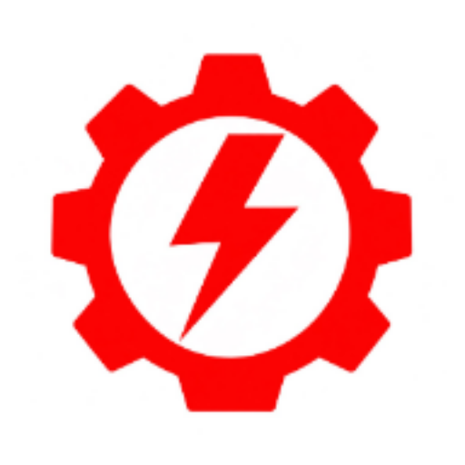

<p align="center">
  
</p>

<h1 align="center">Laser Forge</h1>

<p align="center">
  <strong>Your laser, one tab away.</strong><br />
  Free, open source laser engraver and cutter control that runs entirely in your browser.
</p>

<p align="center">
  <a href="https://github.com/gnomecatstudios/LaserForge">Source code</a> ·
  <a href="https://github.com/gnomecatstudios/LaserForge">Public downloads</a> ·
  <a href="https://github.com/gnomecatstudios/LaserForge/issues">Report an issue</a> ·
  <a href="./portable/README.md">Run locally</a>
</p>

## Rendering and desktop launchers

Laser Forge uses the browser Canvas renderer for design editing and job previews on
all supported platforms. The portable desktop launcher embeds the same production
web app, serves it locally, and opens it in your default browser. Use Chrome, Edge,
or Chromium for machine controls. Keep the launcher window open while using the app. Desktop shortcuts, offline operation,
and the Python-free portable updater remain supported.

## Development downloads and getting started

This is the development repository. [Development releases and downloads](https://github.com/gnomecatstudios/LaserForge/releases) are hosted here. For public downloads, visit [Laser Forge downloads](https://github.com/gnomecatstudios/LaserForge).

The [public Laser Forge downloads repository](https://github.com/gnomecatstudios/LaserForge) has the latest releases and installation instructions for every platform. No GitHub login is required to download the app.

1. Choose a download below, or follow [development setup](#development) to run from source.
2. Extract the portable ZIP and run its launcher. Open Laser Forge in desktop Chrome or Edge for machine control.
3. Create a project, import your artwork, and choose **Connect laser**. Use the virtual machine to practise before connecting hardware.

| Platform | Download |
| --- | --- |
| Windows x64 | [Portable ZIP](https://github.com/gnomecatstudios/LaserForge/releases/latest) |
| Linux x64 | [Portable ZIP](https://github.com/gnomecatstudios/LaserForge/releases/latest) |
| Raspberry Pi OS 64-bit (ARM64) | [Portable ZIP](https://github.com/gnomecatstudios/LaserForge/releases/latest) |
| Raspberry Pi OS 32-bit (ARMv6+) | [Portable ZIP](https://github.com/gnomecatstudios/LaserForge/releases/latest) |

See the [portable setup guide](./portable/README.md) for launch instructions, shortcuts, architecture selection, and troubleshooting. Verify downloads with the [SHA-256 checksums](https://github.com/gnomecatstudios/LaserForge/releases/latest/download/SHA256SUMS.txt).

The launcher serves the app locally at `http://127.0.0.1:5190/`; keep it running while using Laser Forge. A compatible browser must already be installed. For offline text engraving, import the bundled `Fonts/Geist-500.ttf` or your own font through the font picker. Other Google Fonts need an initial download.


### Windows x64

[Download the Windows portable ZIP](https://github.com/gnomecatstudios/LaserForge/releases/latest). Extract the entire ZIP, then double-click `LaserForge-Portable.exe` in the extracted folder. Keep the launcher window open and use Chrome or Edge for machine control.

### Linux x64

[download the Linux portable ZIP](https://github.com/gnomecatstudios/LaserForge/releases/latest), extract it, and run `chmod +x LaserForge-Portable` followed by `./LaserForge-Portable` in the extracted folder. For menu and desktop shortcuts, run `python3 setup.py` or `python3 setup.py --cli`; Python setup is optional.

### Raspberry Pi OS

Run `uname -m` in Terminal to choose the matching package:

- `aarch64`: [portable ZIP](https://github.com/gnomecatstudios/LaserForge/releases/latest).
- `armv6l`, `armv7l`, or `armv8l`: [portable ZIP](https://github.com/gnomecatstudios/LaserForge/releases/latest).

For a portable ZIP, extract it and use the same launcher commands as Linux. A desktop environment and a compatible browser must already be installed. See the [Raspberry Pi guide](./portable/raspberry-pi.md) for architecture and USB access troubleshooting.

### Update popup

Portable builds from version 0.2.1 check for updates on startup. The popup waits until the laser is disconnected and offers **Download update** or **Later**. You can also check from About or the project menu. Downloads are public; no GitHub login is required. Save your project and close the app and launcher before installing the new package. Older versions need one manual download to get the popup.

## What it does

Laser Forge designs, previews and runs jobs on GRBL laser engravers and cutters. Open the app in Chrome or Edge, plug in your laser over USB, and go. No account is needed. The portable version includes the app for offline use.

- **Connect over Web Serial** to GRBL 1.1, grblHAL and FluidNC machines, or practise on the built-in virtual machine.
- **Import art**: SVG and DXF at their real size, PNG, JPEG, WebP, AVIF, BMP and GIF. Drag files anywhere onto the app.
- **Layers** in line, fill and image modes, with speed, power, passes, kerf offset, fill angle, cross-hatch and overscan.
- **Material presets** for engraving and cutting: LaserPecker's own tables per model, and published diode and CO₂ settings by laser power.
- **Image tracing** that turns logos, line art and photos into clean vector layers to cut or engrave, with a live preview.
- **Photo engraving** with Floyd–Steinberg, Atkinson, Jarvis, Stucki, Bayer, threshold and grayscale, previewed live on the bed.
- **Text in any Google Font**, an installed system font or your own TTF, OTF or WOFF files, picked from a searchable list with live previews and burned as clean vector outlines. Bangla, Devanagari, Arabic and other scripts are shaped with HarfBuzz.
- **Outline tool** that draws one cut line around a selection at any offset: a logo and its key-ring hole get a single outline.
- **Node editor**: draw paths node by node (B), click the first node to close a shape, double-click a vector or use N to adjust endpoints and Bézier handles, and unite selected closed shapes. In node mode, click a segment to insert a node; Bézier curves split without changing shape. Enter finishes an open path; Esc cancels.
- **Path simplification** reduces nodes in selected open or closed polylines with a tolerance in millimetres, an original/result preview and one-step undo. Sharp corners are retained; paths containing Bézier curves stay unchanged. For raster images, Simplify opens image tracing with smoothness and corner controls, a live outline preview, and the original image kept by default.
- **Text to paths** converts complete text outlines into node-editable vectors, preserving curves, holes, layers and placement. Undo restores editable text.
- **Layout** aligns objects to selection bounds, the last-selected object or the bed; distributes centres or edge gaps; and previews rectangular and circular arrays before applying them.
- **Text on a path** places editable text on a selected single-path vector, with start/baseline offsets and reverse direction. The baseline is copied; the original guide remains separate.
- **Shape library** with stars, gears, arrows, hearts, callouts and more, each with adjustable parameters, plus rectangle, ellipse and measure tools.
- **Exact placement** with X, Y, W, H and angle fields, a 9-point anchor, and smart guides that snap dragged art to other objects and the bed.
- **Preview** every burn and travel move, scrub through the job, and see a time estimate.
- **Run jobs** with framing (once or looping, laser off or at low power), a visual pre-flight check, pause, resume, live speed and power overrides, and a Stop button that is always on screen (Esc works too).
- **Machine control**: jog pad, homing, set origin, alarm help, an always-visible console of every line sent and received, and a `$$` settings editor with backup and restore.
- **70+ machine presets** from Ortur, Sculpfun, Atomstack, Two Trees, Creality and more, with automatic detection when you connect.
- **CO₂ lasers**: tubes on GRBL boards connect over USB at constant power; Ruida machines (Thunder, Aeon, OMTech and others) get `.rd` job files to run from a USB stick.
- **LaserPecker engravers** over Bluetooth straight from the browser, or USB. See [LaserPecker](#laserpecker).
- **Rotary, slide and two-laser setups** live in the machine profile: pick the rotary in the Machine panel and the work area, axis scaling and mode switch follow; each layer can pick its laser.
- **Send G-code files** straight to the machine.
- **Projects** autosave in the browser and save to disk as `.olaser` files with their images inside. Machine profiles save as `.json`.
- **Print a 1:1 template** of the design as true vector output.

## Browser support

Machine control needs [Web Serial](https://developer.mozilla.org/docs/Web/API/Web_Serial_API), available in Chrome, Edge, Opera and Brave on desktop. Design, preview and G-code export work in other browsers too.

LaserPeckers also connect over [Web Bluetooth](https://developer.mozilla.org/docs/Web/API/Web_Bluetooth_API) in Chrome and Edge. On Linux and in Brave, Bluetooth sits behind a browser setting; press **Connect laser → Bluetooth** and Laser Forge shows where to switch it on.

If your laser does not show up in the port list, install the CH340 or CP210x USB driver. On Linux, add yourself to the `dialout` group and log in again.

## LaserPecker

Laser Forge drives LaserPecker engravers directly. Pick **Connect laser → Bluetooth** or **USB**; the model is detected and its profile set up.

- **Bluetooth from the browser**, with no LaserPecker dongle: the computer's own Bluetooth is enough. LP2, LP3 and LP4 are supported.
- **USB** at 460800 baud: LP2 and LP3 on LaserPecker's own protocol, LP4 and LP5 on G-code with LaserPecker's M-codes, like LightBurn.
- **Frame, engrave, pause and stop** from the app. Framing traces the job's outline at the lowest power.
- **Burn depth and power** as LaserPecker shows them, with LaserPecker's material settings for each model, resolution (1K to 4K) and laser.
- **Both lasers on the LP4 and LP5**: each layer picks 450 nm blue or 1064 nm infrared.
- **Rotary and slide** from the Machine panel, with the work area following.

Over Bluetooth (and on the LP2 and LP3 over USB), the laser takes each layer as an image, so line layers engrave their lines and cannot cut. To cut on an LP4 or LP5, connect over USB.

Protocol details come from the [LaserPecker protocol notes](https://github.com/nerdocs/pyrograph/blob/main/docs/protocol.md) by nerdocs (see [Credits](#credits)). LaserPecker is a trademark of its owner; Laser Forge is not affiliated with it.

## Safety

The laser fires only when you start a job. Framing runs with the laser off unless you enable a low frame power (5% at most). The first job of each session asks you to confirm a short safety checklist. Always wear eye protection rated for your laser, ventilate the room and stay with the machine while it runs.

## Library

Everything under the interface is a library you can build on: [libopenlaser on npm](https://www.npmjs.com/package/libopenlaser). It connects to GRBL lasers over USB and LaserPecker engravers over Bluetooth, exports Ruida `.rd` files, compiles designs to G-code, and imports SVG, DXF, images and fonts.

```bash
npm i libopenlaser
```

```ts
import { compileJob } from 'libopenlaser/cam';
import { GrblConnection, WebSerialTransport } from 'libopenlaser/machine';

const plan = compileJob({ project, profile, assets: new Map() });
const machine = await GrblConnection.open(await WebSerialTransport.request(), profile);
await machine.run({ lines: plan.gcode });
```

The [library README](./packages/libopenlaser/README.md) has guides for each machine, design tools, presets and safety, with examples the tests run.

## Development

Laser Forge is a static Svelte 5 + TypeScript app built with Vite. There is no backend.

```sh
corepack enable          # provides the pinned pnpm version
git clone https://github.com/gnomecatstudios/LaserForge.git
cd LaserForge
pnpm install --frozen-lockfile
pnpm dev                 # http://localhost:5190
```

| Command              | What it does                                                        |
| -------------------- | ------------------------------------------------------------------- |
| `pnpm test`          | Unit, property and golden tests (Vitest)                            |
| `pnpm e2e`           | End-to-end tests against the virtual machine (Playwright, Chromium) |
| `pnpm typecheck`     | `svelte-check` in strict mode                                       |
| `pnpm lint`          | ESLint                                                              |
| `pnpm build`         | Production build in `dist/`, ready for any static host              |
| `pnpm lib:build`     | Build `libopenlaser` into `packages/libopenlaser/dist`              |
| `pnpm golden:update` | Regenerate G-code golden files (review the diff)                    |
| `pnpm screenshot`    | Refresh the README screenshots from a production build              |
| `pnpm icons`         | Render PWA icons and the social preview image                       |
| `pnpm fonts:update`  | Refresh the Google Fonts catalogue from Fontsource                  |

The code is split into layers with one-way dependencies:

- `packages/libopenlaser`: the library the app is built on, published to npm as `libopenlaser`
  - `geometry`: vectors, matrices, paths and polygon offsets
  - `project`: document model, undo history, machine profiles and presets, materials, `.olaser` files
  - `cam`: pure toolpath generation, the G-code emitter and per-controller job encoders
  - `machine`: transports, the machine connection contract, the GRBL and LaserPecker drivers, job streaming and the simulators
  - `import`: SVG, DXF, image and G-code importers
  - `fonts`, `shapes`, `trace`: Google Fonts and text outlines, parametric shapes, image tracing
- `src/lib`: app plumbing: storage, UI primitives, workers and app identity
- `src/app`: the Svelte interface; `src/app/machines` holds one adapter per controller

To support another kind of machine, see [machine integration guide](./docs/adding-a-machine.md).

Design decisions are logged in [design decisions](./docs/decisions.md).

### Deploying

The [Pages workflow](./.github/workflows/pages.yml) builds and deploys pushes to `main` when GitHub Pages is configured to use GitHub Actions. Find a successful deployment’s URL in the repository’s [deployment workflow runs](https://github.com/gnomecatstudios/LaserForge/actions/workflows/pages.yml). A live Laser Forge URL has not been confirmed yet. The build uses relative paths, so it also works from any other static host.

## Contributing

Bug reports and pull requests are welcome. For hardware problems, open the console, press **Download log** and attach the file to your [issue](https://github.com/gnomecatstudios/LaserForge/issues). For questions and suggestions, open an issue in this fork.

## Credits

Laser Forge is a fork of [openlaser](https://github.com/theanam/openlaser.app) by Anam Ahmed.

LaserPecker protocol details come from the [LaserPecker protocol notes](https://github.com/nerdocs/pyrograph/blob/main/docs/protocol.md) by nerdocs. Laser Forge implements the protocol independently from that description; no code from pyrograph is included.

## License

[MIT](./LICENSE)

### Canvas context menu and Boolean operations

Right-click the design canvas for Cut, Copy, Paste, Duplicate, Boolean and Delete.
Right-clicking an unselected object selects it; right-clicking a selected object keeps
the group. Empty space clears selection and offers Paste. Use arrows, Enter and Escape
to navigate or dismiss the menu. Boolean actions require at least two visible, unlocked
vector objects with closed, nondegenerate paths. Hover the disabled Boolean entry for
an explanation. Convert images or text to vectors first; open paths are never closed implicitly.

| Operation | Shortcut | Result |
| --- | --- | --- |
| Union | Ctrl+Shift+U | All selected areas combined |
| Subtract | Ctrl+Shift+D | First-selected object minus all later selections |
| Intersect | Ctrl+Shift+I | Area shared by every selection |
| Exclude (XOR) | Ctrl+Shift+X | Areas covered an odd number of times |

Select the subtraction base first, then Shift-select the cutters. The submenu tooltip
names the base. Every operation preserves the base layer and settings, applies object
transforms, and retains holes and disconnected regions as closed compound paths.
The standalone Union tool remains available. Empty results remove the operands and
clear selection, with an explanatory notification. Undo restores all operands in one step.
Results use the existing line, fill, kerf and G-code pipeline and `.olaser` format.
