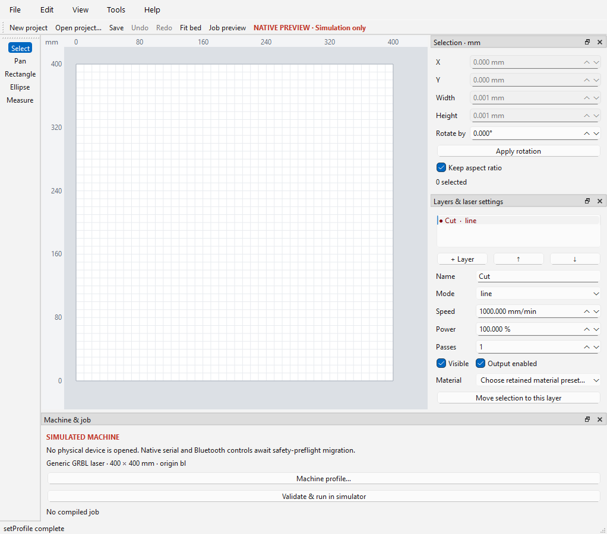

# Native Windows preview

The native Windows x64 editor is an experimental portable Qt application, not the
feature-complete browser release. Its interface uses Qt Widgets and QPainter;
the bundled Node process runs the retained application core without a browser or
local HTTP server. Physical-machine controls and native automatic updates are
not enabled. Keep using the existing browser release for machine operation.

## Download and launch

Download [LaserForge-native-experimental-windows-x64](https://github.com/gnomecatstudios/LaserForge/actions/runs/43737300273/artifacts/14170767639)
from the [verified Windows run](https://github.com/gnomecatstudios/LaserForge/actions/runs/43737300273). GitHub Actions downloads require signing in and expire;
this is not a permanent GitHub Release or the repository's `releases/latest` ZIP.

1. Extract the downloaded Actions artifact. It contains the versioned application
   ZIP, its SHA-256 file and a startup screenshot.
2. Extract **all** of `LaserForge-Native-windows-x64-v0.2.5.zip` into a new folder.
3. Open `LaserForge-Native/LaserForge-Native.exe`. Keep `_internal` alongside the
   executable; it contains Python, Qt, Node, the core bridge, branding and notices.
   You do not need to install Python or Node to run this package.
4. Open a copy of an existing `.olaser` project and use Save As for initial testing.
   See [feature gaps](validation.md) before relying on the native editor.

For optional checksum verification in PowerShell, run next to the inner ZIP:

```powershell
Get-FileHash .\LaserForge-Native-windows-x64-v0.2.5.zip -Algorithm SHA256
Get-Content .\LaserForge-Native-windows-x64-v0.2.5.zip.sha256
```

Compare the hash with the first value in the checksum file. This checks integrity;
the preview executable is not code-signed. Do not overwrite the stable portable
folder or feed this package to the existing browser updater.

## Validation evidence

Initial run [43671765501](https://github.com/gnomecatstudios/LaserForge/actions/runs/43671765501)
built commit `cfabdaa8496af868ed81ebc4e6793cd256815b10` on Windows Server 2025 x64
with Python 3.12.10, Qt/PySide6 6.8.3, Node 24.22.2 and PyInstaller 6.22.3.
All 42 native tests, source startup, package construction and extracted-package
startup passed. Package smoke used a temporary path containing spaces, a separate
working directory, and PATH containing only Windows System32. The checksum,
required bundled files, PNG screenshot and absence of QtWebEngine were checked.
The downloaded archive was additionally checked for ZIP integrity and x64 PE
headers in both the launcher and bundled Node executable.

Visual inspection found missing font glyphs in that run's Qt **offscreen**
screenshot. It is not acceptable evidence of normal Windows desktop rendering.
CI now selects the actual `windows` Qt platform plugin on Windows for both source
tests and packaged startup; Linux keeps `offscreen`.

The corrected run [43737300273](https://github.com/gnomecatstudios/LaserForge/actions/runs/43737300273)
passed on November 15, 2026 (Pacific time), using commit
`3d1d614a0121bd2685eec6c838e08586c42df308` and the same runtime versions above.
All 42 tests passed in 7.758 seconds with `QT_QPA_PLATFORM=windows`; source and
extracted-package startup also passed. The downloaded final archive passed ZIP,
checksum and x64 executable checks. Visual inspection of the actual Windows
plugin screenshot confirmed readable menu/panel text, rulers and grid, resolving
the offscreen-only font problem. This is a startup visual check, not manual
interaction testing or a performance benchmark.

Final inner ZIP: `LaserForge-Native-windows-x64-v0.2.5.zip` (86,459,419 bytes).
SHA-256: `d233c643ce4f2705598397f44b2f68116703402595d8ba81ccb02b15fa4c57bf`.
The Actions artifact expires February 13, 2027 unless retained elsewhere.
The shared package-smoke script also passed against the existing Linux container
artifact after this change; this adds no Mint/Pi validation claim.



## Remaining Windows release gates

- Manual Windows 10/11 installation-free startup, dialogs, file drops, clipboard,
  keyboard/context menus, taskbar icon and 100%/150%/200% display scaling.
- Real user project corpus, complete editing/settings parity and native update
  staging, verification and rollback.
- Code signing and distribution review. GitHub's Windows Server CI is not a
  certification for every supported Windows desktop configuration.
- Native machine adapters and shared safety/preflight/cancel/stop integration,
  verified with simulators before any separately authorized hardware testing.

For source builds, use [distribution.md](distribution.md). The native workflow
builds Windows-only on relevant pushes to `native-render-version-2`; manual/PR
runs retain the full experimental platform matrix. No default launcher, stable
release or physical hardware behavior was changed by this packaging stage.
